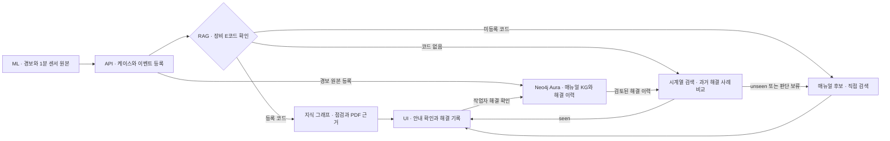

# maintenance-assistant-agent

용접건 센서의 이상을 감지하고, 매뉴얼 근거가 달린 정비 안내를 현장 담당자에게 주는 정비 어시스턴트.


저항 점용접(RSW) 용접건에 이상이 생기면 담당자는 매뉴얼과 과거 이력을 직접 찾아야 합니다. 문서를 그냥 검색하면 다른 모델이나 구버전의 절차가 섞여 나옵니다. 이 프로젝트는 그 일을 세 역할로 나눕니다.

- **ML**이 센서 값에서 이상을 감지합니다.
- **RAG**가 장비 오류 코드, 과거 해결 이력, 매뉴얼을 사용해 점검 근거를 찾습니다.
- **UI**에서 작업자가 안내와 PDF 출처를 검토하고 실제 조치와 해결 여부를 기록합니다.

판단과 조치는 사람이 합니다. 시스템은 케이스 한 건을 점검부터 정비일지까지 처리하도록 돕고, 장비 제어와 고장 원인 확정은 하지 않습니다.

## 작동 방식



시계열 경로는 API에서 `RAG_WARNING_TIMESERIES=1`을 켠 뒤 받은 v1.4 케이스에 적용됩니다. 기존 케이스는 생성 시점의 처리 경로로 열립니다.

**Phase 1 · 이상 탐지 (`ml/`)**

1. 용접건 센서 19종의 값을 1초마다 받습니다.
2. 60초 창마다 피처 46개를 만들고, 설비별 첫 6시간을 기준으로 삼아 IsolationForest + LightGBM으로 이상 점수(0~1)를 냅니다.
3. 운영 기본값에서는 장비 종료 코드(E012·E016·E028·E029)의 규칙이 발동하면 CRITICAL 경보를, 조기 경보 조건이 충족되면 WARNING 경보를 발행합니다.
4. 각 경보는 `event_id`, 19채널 1분 원시값·결측 정보, 상위 기여 피처를 담습니다. 같은 에피소드의 후속 장비 코드는 `episode_id`로 열린 케이스에 연결할 수 있습니다. 작업함의 긴급도는 ML에서 받고, 시계열 RAG 안내는 장비 E코드와 과거 이력으로 결정합니다.

**Phase 2 · 근거 검색 (`rag/`)**

- **등록된 장비 E코드.** Neo4j 지식 그래프에서 검토된 점검·조치와 PDF 근거를 조회합니다. 이 경로에는 Claude나 임베딩 호출이 없습니다.
- **코드 없는 경보.** 같은 채널과 상대 시각의 관측값을 비교해 검증된 과거 해결 사례를 최대 5건 고릅니다. Claude가 파형과 해결 이력을 보고 적용 가능한 사례를 선택하면(`seen`) Aura에 저장된 실제 조치와 출처를 표시합니다. 검색 점수는 비교 후보의 순위를 정합니다.
- **새 경보·판단 보류·미등록 코드.** **원인 후보 보기**를 누르면 키워드·벡터 검색으로 매뉴얼을 찾고, Claude가 검색 근거에서 최대 3개의 점검 후보를 제시합니다. 작업자는 같은 화면에서 직접 검색해 PDF 근거를 선택할 수 있습니다.
- **일반 AI 챗봇.** 별도 화면에서 매뉴얼에 질문할 수 있습니다. [시계열 RAG 연동](rag/docs/warning-timeseries-integration.md)

**Phase 3 · 현장 안내 (`ui/`)**

1. 작업함에서 케이스를 열고 판단에 사용할 경보를 확인합니다.
2. 장비 코드 안내나 과거 해결 카드를 검토합니다. 다른 근거가 필요하면 원인 후보를 요청하거나 직접 매뉴얼을 검색합니다.
3. 적용 근거, 실제 조치, 작업자 확인과 일지 승인을 기록하고 해결로 종료합니다. 화면에 공용 이력 반영 상태가 표시됩니다. 오알람은 별도로 닫을 수 있습니다.

`api/`는 ML의 이벤트를 케이스로 만들고 RAG를 호출합니다. SQLite에는 케이스 상태·임시 입력·전송 대기를 보관합니다. 공용 Neo4j Aura에는 매뉴얼 KG와 재사용할 센서 원본·해결 이력을 저장합니다.

## 피드백 루프

**RAG 피드백 루프**

1. 작업자가 근거를 선택해 조치를 수행하고 해결을 확인합니다.
2. 판단에 사용한 `event_id`에 센서 원본, 적용 근거, 실제 조치와 해결 확인을 연결해 Aura에 저장합니다.
3. 다음 경보에서 검토된 해결 기록 한 건부터 비교할 수 있습니다. Claude가 재사용할 사례를 선택하면 저장된 조치와 PDF를 카드로 보여주고, 작업자가 적용 여부를 결정합니다.

새 PDF 근거를 적용한 해결은 운영자가 출처를 검토한 뒤 재사용됩니다. 오알람 종료는 해결 이력에 포함되지 않습니다.

**ML 피드백 루프 (일부 구현)**

새로 쌓인 데이터로 모델을 다시 학습하고, 지금 쓰는 모델과 비교해 더 나으면 서빙 모델을 바꿉니다.

| 단계 | 내용 | 상태 |
|---|---|---|
| 센서 값 저장 | ML 서버가 받은 센서 값을 계속 쌓음(SQLite) | 미구현. 지금은 새 데이터를 파일로 추가함 |
| 현장 판정 반영 | API의 조기 경보 종료 결과를 가져와 재학습·모델 비교에 사용 | 구현. 피드백 가져오기는 수동 실행 |
| 재학습 | 그때까지 끝난 데이터 전체로 새 모델을 학습 | 구현 |
| A/B 테스트 | 두 모델이 모두 처음 보는 데이터로 비교(섀도 비교). 다섯 조건을 모두 넘어야 교체 | 구현 |
| 배포 | 더 나으면 서버를 다시 켜지 않고 모델을 교체. 되돌리기 가능 | 구현 |

점검을 한 번 부르면(`model_loop.py tick`) 학습, 비교, 교체를 사람 손 없이 진행합니다. 주기적으로 부르는 스케줄러는 아직 등록하지 않았습니다. 실제 데이터 64건을 시간순으로 재생한 결과는 판정 세 번 모두 기존 모델 유지였습니다([보고서](ml/results/D-11/runs/replay-1/report.md)).

## 구현 상태

| 항목 | 상태 | 위치 |
|---|---|---|
| 실시간 이상 탐지와 종료 코드 규칙 | 구현 | `ml/main.py`, `ml/.py/train.py` |
| 조기 경보 (고장 10~60분 전) | 구현 | `ml/main.py` |
| 이상 신호 작성, 보관, 전달 | 구현 | `ml/.py/rag_mapping.py`, `ml/main.py` |
| E 코드 그래프 RAG (코드 4개) | 구현 | `rag/service.py`, `rag/retrieval.py`, `rag/response.py` |
| 19채널 시계열 RAG와 해결 이력 재사용 | 구현, 설정으로 활성화 | `rag/warning_assessment.py`, `rag/warning_series.py`, `rag/warning_memory.py`, `api/warning_bridge.py` |
| 챗봇과 매뉴얼 검색 | 구현 | `api/assistant.py`, `rag/retrieval.py` |
| 케이스 저장과 화면 연결 | 구현 | `api/main.py`, `api/store.py` |
| 작업함, 케이스 처리, 조기 경보 화면, 챗봇 | 구현 | `ui/src/pages/` |
| ML 피드백 루프: 재학습, A/B 테스트(섀도 비교), 모델 교체 | 구현 | `ml/.py/model_loop.py`, `ml/.py/model_registry.py`, `ml/main.py` |
| ML 피드백 루프: 받은 센서 값 저장 (SQLite) | 미구현 | |
| ML 피드백 루프: 현장의 해결·오알람 반영 | 구현, 수동 수집 실행 | `api/ml_feedback.py`, `ml/.py/model_feedback.py`, `ml/.py/model_loop.py` |
| AWS 서빙 | 미구현 (계획, 서비스 종류 미정) | |

ML 모델 파일과 Neo4j 데이터는 구현되어 있지만 저장소 밖에 있습니다. 모델은 [ml/README.md](ml/README.md)의 드라이브 링크에서 받고, 그래프는 팀 공용 Neo4j Aura를 씁니다.

## 구성 요소

| 구성 요소 | 기술 | 역할 | 기본 포트 |
|---|---|---|---|
| ML 서버 (`ml/`) | Python, FastAPI, scikit-learn, LightGBM | 센서 값을 받아 이상을 판정하고 이상 신호를 보냄 | 8000 |
| api 서버 (`api/`) | FastAPI, SQLite | 이상 신호를 케이스로 만들고 RAG를 호출해 화면에 응답 | 9000 |
| RAG (`rag/`) | Python 라이브러리, Claude, OpenAI 임베딩 | 매뉴얼 근거 검색, 정비 안내 생성, 조기 경보 해결 이력. api 프로세스 안에서 호출됨 | |
| 화면 (`ui/`) | React 19, Vite, TypeScript, Tailwind CSS | 작업함, 케이스 처리, 조기 경보 화면, 챗봇 | 5173 |
| Neo4j Aura | 그래프 DB, 벡터·키워드 색인 | 지식 그래프(E 코드 4, 원인 7, 점검 9), 매뉴얼 청크 965개, 조기 경보 해결 이력 | 외부 서비스 |
| SQLite | 파일 DB (`api/state/api.db`) | 케이스, 작업 기록, Neo4j 전송 대기 | |

## 빠른 시작

### 화면만 먼저 보기

서버 없이 고정 데이터로 화면이 뜹니다. Node.js 22.22 이상이 필요합니다.

```bash
cd ui
npm install
cp .env.example .env.local
npm run dev        # http://localhost:5173
```

### 전체를 연결해서 실행

준비물은 세 가지입니다.

- **Python 3.11 이상.** api와 rag는 3.13에서 검증했습니다. ML과 api·rag는 의존성이 달라서 가상환경을 따로 두면 편합니다.
- **모델 파일과 테스트 데이터.** `ml/models/baseline_ensemble.joblib`과 `ml/test/`를 [ml/README.md](ml/README.md)의 "0. 데이터 파일" 링크에서 받습니다. 조기 경보는 2026-11-01 번들에만 들어 있습니다.
- **`rag/.env`.** `rag/.env.example`을 복사해 Neo4j Aura, OpenAI, Anthropic 값을 채웁니다. 값은 팀에서 따로 전달합니다.

시계열 경로를 사용하려면 `rag/.env`에 `RAG_WARNING_TIMESERIES=1`, 팀과 합의한 `RAG_WARNING_NAMESPACE`, 설치 장비에 맞는 `RAG_WARNING_EQUIPMENT_SCOPE`를 설정합니다. 팀 매뉴얼 KG와 검색 인덱스가 준비된 Aura에서 처음 연결할 때, RAG 의존성을 설치한 뒤 저장소 루트에서 `python -m rag.warning_assessment init`으로 이력 제약과 인덱스를 준비합니다.

```bash
# 1) ML 서버
cd ml
pip install -r requirements.txt
uvicorn main:app --port 8000

# 2) api 서버 (새 터미널, 저장소 루트에서)
pip install -r api/requirements.txt
cd api
python -m uvicorn main:app --port 9000

# 3) 화면 (새 터미널). ui/.env.local 에서 VITE_USE_MOCK=false 로 바꾼 뒤
cd ui
npm run dev

# 4) 테스트 데이터를 실시간처럼 재생 (새 터미널)
cd ml
python .py/replay.py test/test_1.csv --start-hours 156 --chunk-s 600
```

재생이 고장 직전에 닿으면 작업함에 케이스가 생깁니다. api는 케이스 목록을 조회할 때 ML 서버에서 이상 신호를 가져옵니다.

**모델 파일 없이 A~D를 확인하려면** [시연 실행 절차](docs/timeseries-rag-integration-report.md#팀에서-다시-실행하기)를 따라 합성 경보를 재생할 수 있습니다. [A~D HTML 보고서](docs/timeseries-rag-browser-demo.html)를 내려받아 브라우저에서 열면 서버 없이 실제 화면과 클릭 순서를 볼 수 있습니다.

### 설정

아래 기능은 서버를 켤 때 설정을 줘야 동작합니다.

| 설정 | 주는 곳 | 주지 않으면 | 주면 |
|---|---|---|---|
| `RSW_EARLY_WARNING_HANDOFFS=0` | ML 서버 환경 변수 | (11/13부터 기본 켜짐) 조기 경보가 api로 가서 WARNING 케이스가 생김 | 조기 경보를 계산만 하고 보내지 않음 |
| `RSW_MODEL_CRITICAL=1` | ML 서버 환경 변수 | 모델 알람만으로는 CRITICAL이 되지 않음 (CRITICAL = 종료 코드뿐) | 예전 동작: 모델 알람이 10분 이어지면 코드 없는 CRITICAL. 비교·재현용 |
| `RAG_WARNING_TIMESERIES=1` | `rag/.env` 또는 API 환경 변수 | 기존 경보 처리 경로 사용 | 새 v1.4 케이스에서 E코드·시계열 이력·매뉴얼 경로 사용 |
| `RAG_WARNING_NAMESPACE` | `rag/.env` | 시계열 이력 저장·조회에 필요한 설정이 빠진 상태 | 같은 Aura와 같은 값을 쓰는 팀이 해결 이력을 공유 |
| `RAG_WARNING_EQUIPMENT_SCOPE` | `rag/.env` | 시계열 이력 비교 보류 | 설치 장비의 적용 범위(예: `cpx-weld-2g-sa`)가 맞는 검토 이력을 비교 |
| `RSW_MODEL_REGISTRY=models/registry` | ML 서버 환경 변수 | 모델 파일 하나를 고정해서 씀 | 모델 등록부의 현재 모델을 쓰고, 루프가 교체하면 다시 켜지 않아도 바뀜 |
| `FIELD_MEMORY=1` | api 서버 환경 변수 | 닫힌 케이스 기록을 보여 주지 않음 | 같은 설비·코드로 닫힌 케이스를 "이전 기록"으로 보여 줌 |

```bash
uvicorn main:app --port 8000                                            # 조기 경보 전송 켜짐 (기본)
RSW_EARLY_WARNING_HANDOFFS=0 uvicorn main:app --port 8000               # 끄기 (bash)
$env:RSW_EARLY_WARNING_HANDOFFS='0'; uvicorn main:app --port 8000       # 끄기 (PowerShell)
```

### 테스트

```bash
(cd ml && python -m pytest)                  # 합성 데이터로 전처리부터 서빙까지
python -m pytest rag/tests api/tests -q      # 저장소 루트에서. 외부 모델과 DB는 모의 처리
(cd ui && npm run test:warning && npm run build)  # API 의존성이 설치된 Python 환경에서 실행
```

## 저장소 구조

```
maintenance-assistant-agent/
├── api/    # API 서버 — UI와 ml·rag를 연결
├── ml/     # 모델 학습·추론
├── rag/    # 문서 인덱싱·검색·LLM 호출
├── ui/     # 프론트엔드 (api만 호출)
└── docs/   # 통합 개발 보고서와 브라우저 시연
```

- 각 폴더의 의존성은 그 폴더 안에서 관리합니다(`requirements.txt`, `package.json` 등).
- 모델 가중치, 현장 입력 데이터, DB 파일, `.env`는 팀에서 별도로 관리합니다. 시연·평가용 합성 입력은 재현을 위해 저장소에 둡니다.

## 문서

| 파트 | 문서 | 내용 |
|---|---|---|
| ML | [ml/README.md](ml/README.md) | 데이터, 접근 방식, 파이프라인 실행 순서 |
| | [ml/test.md](ml/test.md) | 현재 모델의 테스트셋 결과 |
| | [ml/techspec.md](ml/techspec.md) | 남은 개발 명세 |
| | [ml/docs/early-warning-handoff.md](ml/docs/early-warning-handoff.md) | 조기 경보 신호 안내 |
| | [ml/docs/superpowers/specs/2026-11-11-model-loop-design.md](ml/docs/superpowers/specs/2026-11-11-model-loop-design.md) | 모델 루프(재학습, 섀도 비교, 교체) 설계 |
| RAG | [rag/README.md](rag/README.md) | 개발 현황과 실행 안내 |
| | [시계열 RAG 연동 계약](rag/docs/warning-timeseries-integration.md) | ML 핸드오프, API·UI 응답, Aura 해결 저장 |
| | [통합 개발 보고서](docs/timeseries-rag-integration-report.md) · [A~D 시연](docs/timeseries-rag-browser-demo.html) | 모듈별 변경과 실제 화면 검증 |
| | [50건 평가 보고서](rag/evaluation/timeseries_report.md) | 새 경보의 후보와 이전 해결 카드의 Precision·Recall |
| | [기존 WARNING 연동 계약](rag/docs/early-warning-integration.md) | 기존 케이스의 센서 방향 기반 처리 |
| api | [api/README.md](api/README.md) | 실행, 연결, 저장 |
| | [api/docs/warning-api-20261111.md](api/docs/warning-api-20261111.md) | WARNING API 계약 |
| UI | [ui/README.md](ui/README.md) | 실행 방법과 폴더 안내 |
| | [ui/docs/01-project-background.md](ui/docs/01-project-background.md) | 프로젝트 배경 |
| | [ui/docs/10-early-warning-rag-ui.md](ui/docs/10-early-warning-rag-ui.md) | 조기 경보 화면 안내 |
| | [ui/wireframe/README.md](ui/wireframe/README.md) | 와이어프레임 |

## 한계

이 저장소는 8주 프로젝트의 MVP입니다. 현업 워크플로우를 재현하는 것이 목적이고, 현업에서 바로 쓸 성능이 목표는 아닙니다.

- **수 시간 전 예지는 되지 않습니다.** 이 데이터로는 불가능하다고 판정했습니다. 보장되는 감지 시점은 종료 코드가 뜨는 고장 약 10분 전입니다.
- **조기 경보는 정밀도가 낮습니다.** 놓치지 않는 쪽을 우선해서, 고장 둘 중 하나에서 10~60분 전에 켜지고 오경보는 설비당 하루 약 16회입니다.
- **모델을 교체하면 설비마다 6시간 동안 모델 알림과 조기 경보가 나가지 않습니다.** 설비별 기준을 새 모델로 다시 잡기 때문입니다. 종료 코드 규칙 알림은 계속 나갑니다.
- **안내 카드가 있는 오류 코드는 네 개입니다.** E012, E016, E028, E029입니다.
- **센서 값을 매뉴얼의 수치 기준과 비교하지 않습니다.** 공개 데이터의 센서 이름과 단위가 가려져 있습니다.
- **시계열 안내의 현장 정비 성능은 추가 검증이 필요합니다.** 합성 평가의 자동 후보 Precision은 16.67%, Recall은 9.09%였습니다. 정답 과거 이벤트를 지정한 경우에는 해결 카드 20건을 그대로 재현했습니다. [평가 결과와 조건](rag/evaluation/timeseries_report.md)
- **실제 설비에 연결한 적이 없습니다.** 센서 입력은 공개 데이터를 재생한 것입니다.
- **사진은 저장만 하고 분석하지 않습니다.**
- **첫 안내 생성에 평균 약 10초가 걸립니다.** 같은 답은 캐시에서 다시 씁니다.

## 데이터와 문서 출처

**센서 데이터.** Xiaoye Wang, Changsheng Zhang, Tao Wang. "Benchmark for welding gun fault prediction with multivariate time series data." *Scientific Data* 11, 83 (2024). https://doi.org/10.1038/s41597-024-02914-z

용접건 80대의 고장 전 약 7일을 1초 간격으로 담은 공개 데이터입니다. 학습용 72개와 테스트용 8개로 나뉩니다.

**매뉴얼 4종 (`rag/data/`).**

| 인용 이름 | 문서 | 쪽수 |
|---|---|---:|
| festo | Festo 서보 공압 용접건 매뉴얼 (구판) | 101 |
| manual82 | CPX-WELD-2G-SA 시스템 매뉴얼 | 82 |
| diagnostic4 | CPX-WELD-2G-SA 오류 진단 문서 | 4 |
| whitepaper11 | 공압 구동 장치 예지보전 문서 | 11 |
