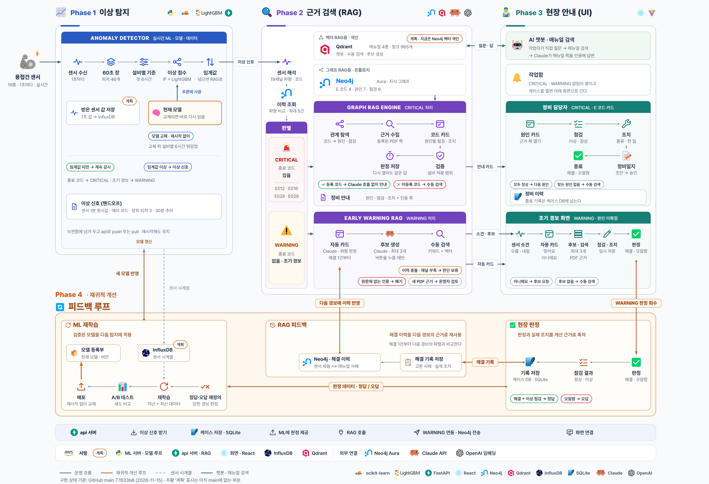

# maintenance-assistant-agent

**RSW 정비 지원.** 용접건 센서의 이상을 감지하고, 매뉴얼 근거가 달린 정비 안내를 현장 담당자에게 주며, 현장 판정으로 스스로 나아지는 정비 어시스턴트.


저항 점용접(RSW) 용접건에 이상이 생기면 담당자는 매뉴얼과 과거 이력을 직접 찾아야 합니다. 문서를 그냥 검색하면 다른 모델이나 구버전의 절차가 섞여 나옵니다. 이 프로젝트는 그 일을 세 역할로 나눕니다.

- **ML**이 센서 값에서 이상을 감지합니다.
- **RAG**가 장비 오류 코드, 과거 해결 이력, 매뉴얼을 사용해 점검 근거를 찾습니다.
- **UI**에서 작업자가 안내와 PDF 출처를 검토하고 실제 조치와 해결 여부를 기록합니다.

판단과 조치는 사람이 합니다. 시스템은 케이스 한 건을 점검부터 정비일지까지 처리하도록 돕고, 장비 제어와 고장 원인 확정은 하지 않습니다.

작업자의 판정은 다시 시스템으로 돌아갑니다. 확인된 해결은 다음 경보의 안내가 되고(RAG), 판정은 모델 재학습에 쓰입니다(ML). ML, RAG, 온톨로지(지식 그래프), 피드백 루프를 한 바퀴로 묶은 것이 이 프로젝트의 핵심입니다.

## 왜 만들었나

**AI는 알림까지만 돕고, 그 뒤는 줄어드는 숙련자에게 달려 있습니다.**

| 숫자 | 뜻 | 출처 |
|---|---|---|
| 230만 달러 | 대형 자동차 공장이 계획에 없이 1시간 멈출 때의 비용. 삼성 평택은 30분 미만 정전에 약 500억 원 | Siemens 2024, 헤럴드경제 2026 |
| 58% | 정비팀이 AI를 쓴다 (정비·운영 리더 2,234명 조사) | MaintainX 2026 |
| 79% | 그래도 계획에 없던 정지는 그대로이거나 늘었다 (같은 조사) | MaintainX 2026 |

정비 담당자의 일은 네 단계로 이어집니다. 지금의 AI가 돕는 곳은 첫 단계뿐입니다.

| 단계 | 지금 |
|---|---|
| 1. 센서 이상 알림 | AI가 돕는 곳 |
| 2. 화면에는 코드 번호만 나온다 | |
| 3. 무엇을 점검할지 찾는다 | **막히는 곳.** 영문 매뉴얼 198쪽을 뒤지거나 숙련자에게 묻습니다. 한국 제조업은 10명 중 4명이 50대 이상입니다 |
| 4. 조치하고 기록한다 | **막히는 곳.** 기록이 다음 고장에 쓰이지 않습니다 |

이 프로젝트는 3단계와 4단계를 맡습니다. 경보가 울린 뒤 무엇을 점검할지를 매뉴얼 근거로 안내하고, 조치 기록을 다음 경보에 다시 씁니다.

## 기존 제품과 다른 점

장비사 다섯 곳의 공개 자료를 네 가지로 비교했습니다(2026년 11월 조사). 네 가지를 모두 갖춘 곳은 찾지 못했습니다.

| 장비사 (제품) | ML | RAG | 온톨로지 | 피드백 루프 |
|---|:---:|:---:|:---:|:---:|
| Siemens (Senseye) | ○ | ○ | ✕ | △ 방법 비공개 |
| Siemens (특허 출원 EP4687064A1) | | | △ | |
| ABB (My Measurement Assistant+) | ○ | ○ | ✕ | ✕ |
| Festo (Festo AX) | ○ | | ✕ | △ |
| Festo (Virtual Assistant) | | △ | ✕ | |
| FANUC (ZDT) | ○ | ✕ | ✕ | ✕ |
| Bosch Rexroth (PRC7000 용접 제어기) | △ | | ✕ | |
| Bosch Rexroth (Manufacturing Co-Intelligence) | | △ | ✕ | △ |
| **이 프로젝트** | ○ | ○ | ○ | ○ |

○ 있음 · △ 일부만 · ✕ 공개 자료에 없음 · 빈칸은 그 제품의 범위가 아님

가장 앞선 방식은 Siemens의 특허 출원입니다. 비전문가가 말, 사진, 영상으로 신고하면 LLM이 지식 그래프와 해결책 DB에서 답을 찾습니다. 이 방식은 현장에서 실현되기 어렵다고 판단했고, 그래서 세 가지를 다르게 했습니다.

| 어려운 이유 | 근거 | 이 프로젝트의 선택 |
|---|---|---|
| 사람의 설명은 모호하다 | 설명이 모호하거나 센서가 빠지면 AI가 정비 과제를 끝까지 해낸 비율이 34% 줄었다 (IBM AssetOpsBench, 2026) | **판단 범위를 줄였다.** 기계 신호와 E 코드에서 시작한다 |
| 범위가 넓으면 문서가 많아진다 | 긴 문서를 통째로 넣자 AI 모델 13개 중 11개의 정답률이 절반 아래로 떨어졌다 (NoLiMa, ICML 2025) | **필요한 근거만 넣는다.** 온톨로지와 RAG로 찾아서 넣는다 |
| 공장마다 설비 상태가 다르다 | 한 기계에서 배운 고장 진단을 다른 기계에 쓰면 100번 중 75번쯤만 맞고, 그 기계의 사례 하나를 알려 주면 98번 맞는다 (교차 설비 고장 진단 연구, 2020) | **공장별로 최적화한다.** 현장 판정이 온톨로지와 ML을 고친다 |

범위는 용접건 한 종류, 센서 19종, E 코드 4개, 매뉴얼 4종 198쪽입니다.

## 작동 방식

[](docs/assets/architecture.png)

> 구현 상태 기준: main `77633b6`(2026-11-15). 주황색 **계획** 표시가 붙은 세 곳(받은 센서 값의 InfluxDB 저장, Qdrant 색인, AWS 서빙)은 아직 main에 없습니다. 벡터 검색은 지금 Neo4j의 벡터 색인으로 합니다. 그림은 코드에 반영된 구조이며 현장 성능 검증을 뜻하지 않습니다. 그림을 누르면 크게 볼 수 있습니다.

**그림 읽는 법.** 위쪽 세 칸이 운영 흐름입니다. 왼쪽은 ML의 이상 탐지, 가운데는 RAG의 근거 검색, 오른쪽은 작업자의 정비 화면입니다. 아래 주황 띠는 피드백 루프로, 현장 판정이 해결 이력(RAG)과 재학습(ML)으로 돌아갑니다. 남색 선은 운영 흐름, 주황 선은 피드백 루프, 회색 점선은 센서 시계열, 초록 선은 챗봇과 매뉴얼 검색입니다.

| 핵심 구분 | 실제 동작 (main) |
|---|---|
| 센서 분석 범위 | 19채널 1분 원시 파형을 복원하고 같은 채널·상대 시각·값을 비교. 기여 상위 3개는 별도 설명 정보 |
| 시계열 이력 재사용 | 시계열 경로에서는 검토된 과거 해결 1건부터 비교. 후보 최대 5건을 Claude가 판단해 Seen / Unseen / 판단 보류로 구분 |
| 등록 E코드 안내 | 시계열 경로의 등록 E코드는 KG의 검토 카드·PDF를 직접 조회하며 Claude·임베딩을 호출하지 않음. 기존 모드의 안내 생성은 유지 |
| WARNING과 CRITICAL | 운영 기본값에서는 모델의 지속 경보만으로 CRITICAL을 만들지 않음. 장비 종료 코드가 발생하면 같은 에피소드에 연결하고 긴급 표시 |
| ML 작업자 판정 반영 | 조기경보 종료 결과와 이상 점검 유무를 함께 읽어 ML 판정을 구성. 해결 확인만으로 모두 학습 정답이 되지는 않음 |
| SQLite 저장 범위 | API의 경보 원본·케이스·정비 기록 저장은 구현. 모든 센서 스트림을 계속 저장해 재학습 데이터로 만드는 별도 기능은 미구현 |


시계열 경로는 API에서 `RAG_WARNING_TIMESERIES=1`을 켠 뒤 받은 v1.4 케이스에 적용됩니다. 기존 케이스는 생성 시점의 처리 경로로 열립니다.

**Phase 1 · 이상 탐지 (`ml/`)**

1. 용접건 센서 19종의 값을 1초마다 받습니다.
2. 60초 창마다 피처 46개를 만들고, 설비별 첫 6시간을 기준으로 삼아 IsolationForest + LightGBM으로 이상 점수(0~1)를 냅니다.
3. 운영 기본값에서는 장비 종료 코드(E012·E016·E028·E029)의 규칙이 발동하면 CRITICAL 경보를, 조기 경보 조건이 충족되면 WARNING 경보를 발행합니다.
4. 각 경보는 `event_id`, 19채널 1분 원시값·결측 정보, 상위 기여 피처 최대 3개를 담습니다. 센서 해석이 확인되지 않은 `c19`는 수치 비교에만 쓰고 정비 원인이나 장비 기능을 추정하지 않습니다. 같은 에피소드의 후속 장비 코드는 `episode_id`로 열린 케이스에 연결할 수 있습니다. 같은 에피소드에 장비 CRITICAL이 추가되면 API가 케이스의 긴급도를 올립니다. 시계열 RAG 안내는 장비가 보고한 E코드와 과거 해결 이력으로 결정합니다.

| 경보 | 나가는 조건 |
|---|---|
| CRITICAL | 종료 코드(E012·E016·E028·E029)가 나타나면 즉시 나갑니다. 모델과 무관한 규칙입니다 |
| WARNING | 코드 없이 이상 점수가 조기 경보 기준을 넘는 1분이 나오면 나갑니다. 같은 설비에는 60분에 한 번입니다 |

| 고른 것 | 이유 |
|---|---|
| 60초 창과 피처 46개 | 묶는 길이 다섯 가지(1분~6시간)를 비교해 1분을 골랐습니다. `c19`는 시간이 지나면 저절로 오르는 값이라 "고장까지 남은 시간"을 알려 주는 셈이어서 모델 입력에서 뺐습니다 |
| IsolationForest + LightGBM | 모델 7종의 조합 99개를 운영과 같은 경보 방식으로 비교해 골랐습니다 |
| 상위 기여 피처 3개 | 피처를 하나씩 정상값으로 바꿔 점수가 얼마나 내려가는지 보고, 가장 많이 내려간 3개를 경보에 담습니다 |

실험 경과는 [ml/history.md](ml/history.md)에 있습니다.

**Phase 2 · 근거 검색 (`rag/`)**

- **등록된 장비 E코드.** Neo4j 지식 그래프에서 검토된 점검·조치와 PDF 근거를 조회합니다. 이 경로에는 Claude나 임베딩 호출이 없습니다.
- **코드 없는 경보.** 19채널 원시 파형을 1초 단위로 복원하고 창 끝을 0초로 정렬합니다. 같은 채널과 상대 시각의 관측값·결측 범위를 비교해 검토된 과거 해결 사례를 최대 5건 고릅니다. 설비 적용 범위가 같고 현재 경보 이전에 해결된 다른 에피소드의 기록만 비교합니다. Claude가 파형과 해결 이력을 보고 적용 가능한 사례를 선택하면(`seen`) Aura에 저장된 실제 조치와 출처를 표시합니다. 검색 점수는 비교 후보의 순위를 정합니다.
- **새 경보·판단 보류·미등록 코드.** **원인 후보 보기**를 누르면 키워드·벡터 검색으로 매뉴얼을 찾고, Claude가 검색 근거에서 최대 3개의 점검 후보를 제시합니다. 작업자는 케이스 안에서 앞 대화를 이어 매뉴얼을 검색하고 등록 사례 또는 PDF 근거를 선택할 수 있습니다. 설명 생성만 실패한 경우에도 검색된 PDF 근거는 계속 사용할 수 있습니다.
- **일반 AI 챗봇.** 별도 화면에서 매뉴얼에 질문할 수 있습니다. [시계열 RAG 연동](rag/docs/warning-timeseries-integration.md)

**Phase 3 · 현장 안내 (`ui/`)**

1. 작업함의 긴급·조기경보 탭에서 케이스를 열고 판단에 사용할 경보를 선택합니다. 후속 장비 코드가 연결된 케이스는 긴급으로 표시하며 최신 코드를 함께 보여 줍니다.
2. 장비 코드 안내나 과거 해결 카드를 검토합니다. 다른 근거가 필요하면 원인 후보를 요청하거나 직접 매뉴얼을 검색합니다.
3. 현재 시계열 케이스는 점검 → 조치 → 정비일지 순서로 처리합니다. 등록 사례는 `manual_case_id`, PDF 근거는 `evidence_id`로 선택하고, 선택한 `event_id`를 다음 정비 단계까지 유지합니다. 실제 조치, 작업자 해결 확인과 일지 승인을 기록하고 종료합니다. 화면에 공용 이력 반영 상태가 표시됩니다. 오알람은 별도로 닫을 수 있습니다.

`api/`는 ML의 이벤트를 케이스로 만들고 RAG를 호출합니다. RAG는 별도 서버가 아니라 API 프로세스 안에서 실행되는 Python 라이브러리입니다. 기존 모드의 CRITICAL 화면과 그래프 RAG 경로는 유지합니다.

| 저장소 | 실제로 보관하는 것 | 사용하는 곳 |
|---|---|---|
| API SQLite (`api/state/api.db`) | 경보 핸드오프 원본·반복 이벤트, 케이스 상태, 점검·조치·정비일지, 임시 입력, Aura 전송 대기 | 작업함·정비 화면 복원, 전송 재시도, 종료 판정 조회 |
| 공용 Neo4j Aura | 매뉴얼 KG·검색 인덱스, 등록한 경보의 19채널 1분 창, 판정, 검토된 근거·해결 이력 | 코드 안내, 파형 비교, 과거 조치·PDF 재사용 |
| ML 모델 레지스트리·파일 | 모델 번들·비교 결과, 수집한 작업자 판정(`feedback.json`), 전처리 데이터 파일 | 재학습·섀도 비교·서빙 모델 교체 |

SQLite에 경보가 저장된다는 것은 모든 센서 스트림이 재학습 데이터로 자동 적재된다는 뜻은 아닙니다. 케이스와 해결 종료·전송 대기를 SQLite에 먼저 보존하고, 재사용할 해결 기록을 Aura로 전달합니다.

## 피드백 루프

**RAG 피드백 루프**

1. 작업자가 근거를 선택해 조치를 수행하고 해결을 확인합니다.
2. 판단에 사용한 `event_id`에 센서 원본, 적용 근거, 실제 조치와 해결 확인을 연결해 Aura에 저장합니다.
3. 다음 경보에서 검토된 해결 기록 한 건부터 비교할 수 있습니다. Claude가 재사용할 사례를 선택하면 저장된 조치와 PDF를 카드로 보여주고, 작업자가 적용 여부를 결정합니다.

새 PDF 근거를 적용한 해결은 운영자가 출처를 검토한 뒤 재사용됩니다. 오알람 종료는 해결 이력에 포함되지 않습니다.

**ML 피드백 루프 · 판정 반영·재학습·모델 교체 구현**

새로 쌓인 데이터로 모델을 다시 학습하고, 지금 쓰는 모델과 비교해 더 나으면 서빙 모델을 바꿉니다.

| 단계 | 내용 | 상태 |
|---|---|---|
| 센서 값 저장 | ML 서버가 받은 센서 값을 계속 쌓음(계획: InfluxDB) | 미구현. 지금은 새 데이터를 파일로 추가함 |
| 현장 판정 반영 | API의 조기 경보 종료 결과를 가져와 재학습·모델 비교에 사용 | 구현. 피드백 가져오기는 수동 실행 |
| 재학습 | 그때까지 끝난 데이터 전체로 새 모델을 학습 | 구현 |
| A/B 테스트 | 두 모델이 모두 처음 보는 데이터로 비교(섀도 비교). 조건 다섯 가지를 계산하고, 그중 세 가지(AUROC 차, 조기 경보 적중, 오알람 상한)를 모두 넘어야 교체 | 구현 |
| 배포 | 더 나으면 서버를 다시 켜지 않고 모델을 교체. 되돌리기 가능 | 구현 |

조기경보의 종료 사실은 `GET /api/ml/feedback`으로 제공하고, ML의 `model_loop.py feedback pull` 실행으로 모델 레지스트리에 가져옵니다. API가 “고장 유형 정답”을 만들어 보내는 구조는 아닙니다.

| ML 판정 | 조건 | 처리 |
|---|---|---|
| `confirmed` | 해결 종료 + 이상으로 기록된 점검 1개 이상 + 데이터 파일·시간 일치 | 해당 경보 이후 구간을 정상 학습 데이터에서 제외하고 평가에 반영 |
| `false_alarm` | 오알람으로 종료 + 데이터 파일·시간 일치 | 오알람 구간과 결과를 별도 기록 |
| `unknown` | 해결 종료했지만 이상 점검 근거가 없음 | 기록은 남기고 학습 판정으로 사용하지 않음 |
| `unmatched` | 설비 또는 경보 시각이 전처리 데이터 파일과 맞지 않음 | 기록은 남기고 학습 판정으로 사용하지 않음 |

점검을 한 번 부르면(`model_loop.py tick`) 학습, 비교, 교체를 사람 손 없이 진행합니다. 주기적으로 부르는 스케줄러는 아직 등록하지 않았습니다.

실제 데이터 64건을 시간순으로 재생했을 때, 지금 기본 조건에서는 판정 세 번 가운데 한 번 모델을 교체했습니다(v001 → v003). 다섯 조건을 모두 요구하던 첫 재생에서는 세 번 모두 기존 모델을 유지했습니다. 작업자 판정 1건이 api에서 다음 학습까지 반영되는 것도 확인했습니다. 자세한 내용은 [평가 3번과 4번](evaluation/README.md#3-모델-루프-재생)에 있습니다.

## 평가 결과

감지, 근거 검색, 답변, 경고 안내를 단계마다 확인했습니다. 평가별 자료, 방법, 주의할 점과 보고서는 [evaluation/](evaluation/README.md)에 모았습니다.

| 단계 | 확인한 것 | 결과 |
|---|---|---|
| 감지 | 종료 코드 규칙이 고장 전에 켜지는가 | 테스트 8/8건, 고장 전 중앙값 9.2분. 모델과 무관한 규칙입니다 |
| 감지 | ML 조기 경보가 종료 코드 10~60분 전에 켜지는가 | 테스트 4/8건(우연이면 21%), 오경보 설비당 하루 8.3회 |
| 감지 | 고장 전과 정상을 가려내는 정도 (AUROC. 0.5는 찍기, 1은 완벽) | 0.713. IsolationForest 단독 0.645에서 LightGBM을 더해 올렸습니다 |
| 근거 검색 | 필요한 매뉴얼 근거 가운데 찾아온 비율 (Context Recall) | 0.913 (개선 전 0.875) |
| 근거 검색 | 쓸모 있는 근거가 앞쪽에 온 정도 (Context Precision) | 0.671 |
| 답변 | 답변 내용 가운데 찾아온 근거로 뒷받침되는 비율 (Faithfulness) | 0.979. 매뉴얼 질문 50개, 평균 응답 10.6초 |
| 경고 안내 | 재발한 경보에 맞는 과거 해결 카드를 돌려주는가 | 20/20건. 어긋난 이력 5건은 모두 보류했습니다 |
| 경고 안내 | 처음 보는 경보에 매뉴얼 후보를 자동으로 주는가 | 후보 가운데 맞은 것 16.67%, 정답 가운데 찾아낸 것 9.09%. 그래서 후보가 없으면 작업자가 직접 검색합니다 |
| 피드백 루프 | 해결 기록이 다음 경보의 안내가 되는가 | 합성 경보 A, C를 해결하자 재발 경보 B, D가 그 조치를 돌려줬습니다 |

기준 자료는 공개 데이터의 테스트 8건, 매뉴얼 질문 50개, 정답을 정해 둔 합성 경보 50건입니다. 실제 설비에서 잰 수치는 없습니다.

## 구현 상태

| 항목 | 상태 | 위치 |
|---|---|---|
| 실시간 이상 탐지와 종료 코드 규칙 | 구현 | `ml/main.py`, `ml/.py/train.py` |
| 조기 경보 (고장 10~60분 전) | 구현 | `ml/main.py` |
| 이상 신호 작성, 보관, 전달 | 구현 | `ml/.py/rag_mapping.py`, `ml/main.py` |
| E 코드 그래프 RAG (코드 4개) | 구현 | `rag/service.py`, `rag/retrieval.py`, `rag/response.py` |
| 19채널 시계열 RAG와 해결 이력 재사용 | 구현, 설정으로 활성화 | `rag/warning_assessment.py`, `rag/warning_series.py`, `rag/warning_memory.py`, `api/warning_bridge.py` |
| 챗봇과 매뉴얼 검색 | 구현 | `api/assistant.py`, `rag/retrieval.py` |
| 케이스 저장과 화면 연결 | 구현 | `api/main.py`, `api/store.py` |
| 작업함, 케이스 처리, 조기 경보 화면, 챗봇 | 구현 | `ui/src/pages/` |
| ML 피드백 루프: 재학습, A/B 테스트(섀도 비교), 모델 교체 | 구현 | `ml/.py/model_loop.py`, `ml/.py/model_registry.py`, `ml/main.py` |
| ML 피드백 루프: 받은 센서 값 저장 (계획: InfluxDB) | 미구현 | |
| 벡터 색인을 Qdrant로 분리 | 미구현 (계획). 지금은 Neo4j의 벡터 색인을 씀 | `rag/retrieval.py` |
| ML 피드백 루프: 현장의 해결·오알람 반영 | 구현, 수동 수집 실행 | `api/ml_feedback.py`, `ml/.py/model_feedback.py`, `ml/.py/model_loop.py` |
| AWS 서빙 | 미구현 (계획, 서비스 종류 미정) | |

ML 모델 파일과 Neo4j 데이터는 구현되어 있지만 저장소 밖에 있습니다. 모델은 [ml/README.md](ml/README.md)의 드라이브 링크에서 받고, 그래프는 팀 공용 Neo4j Aura를 씁니다.

## 구성 요소

| 구성 요소 | 기술 | 역할 | 기본 포트 |
|---|---|---|---|
| ML 서버 (`ml/`) | Python, FastAPI, scikit-learn, LightGBM | 센서 값을 받아 이상을 판정하고 이상 신호를 보냄 | 8000 |
| api 서버 (`api/`) | FastAPI, SQLite | 이상 신호를 케이스로 만들고 RAG를 호출해 화면에 응답 | 9000 |
| RAG (`rag/`) | Python 라이브러리, Claude, OpenAI 임베딩 | 매뉴얼 근거 검색, 정비 안내 생성, 조기 경보 해결 이력. api 프로세스 안에서 호출됨 | |
| 화면 (`ui/`) | React 19, Vite, TypeScript, Tailwind CSS | 작업함, 케이스 처리, 조기 경보 화면, 챗봇 | 5173 |
| Neo4j Aura | 그래프 DB, 벡터·키워드 색인 | 지식 그래프(E 코드 4, 원인 7, 점검 9), 매뉴얼 청크 965개, 조기 경보 해결 이력 | 외부 서비스 |
| SQLite | 파일 DB (`api/state/api.db`) | 케이스, 작업 기록, Neo4j 전송 대기 | |

## 빠른 시작

### 화면만 먼저 보기

서버 없이 고정 데이터로 화면이 뜹니다. Node.js 22.22 이상이 필요합니다.

```bash
cd ui
npm install
cp .env.example .env.local
npm run dev        # http://localhost:5173
```

### 전체를 연결해서 실행

준비물은 세 가지입니다.

- **Python 3.11 이상.** api와 rag는 3.13에서 검증했습니다. ML과 api·rag는 의존성이 달라서 가상환경을 따로 두면 편합니다.
- **모델 파일과 테스트 데이터.** `ml/models/baseline_ensemble.joblib`과 `ml/test/`를 [ml/README.md](ml/README.md)의 "0. 데이터 파일" 링크에서 받습니다. 조기 경보는 2026-11-01 번들에만 들어 있습니다.
- **`rag/.env`.** `rag/.env.example`을 복사해 Neo4j Aura, OpenAI, Anthropic 값을 채웁니다. 값은 팀에서 따로 전달합니다.

시계열 경로를 사용하려면 `rag/.env`에 `RAG_WARNING_TIMESERIES=1`, 팀과 합의한 `RAG_WARNING_NAMESPACE`, 설치 장비에 맞는 `RAG_WARNING_EQUIPMENT_SCOPE`를 설정합니다. 팀 매뉴얼 KG와 검색 인덱스가 준비된 Aura에서 처음 연결할 때, RAG 의존성을 설치한 뒤 저장소 루트에서 `python -m rag.warning_assessment init`으로 이력 제약과 인덱스를 준비합니다.

```bash
# 1) ML 서버
cd ml
pip install -r requirements.txt
uvicorn main:app --port 8000

# 2) api 서버 (새 터미널, 저장소 루트에서)
pip install -r api/requirements.txt
cd api
python -m uvicorn main:app --port 9000

# 3) 화면 (새 터미널). ui/.env.local 에서 VITE_USE_MOCK=false 로 바꾼 뒤
cd ui
npm run dev

# 4) 테스트 데이터를 실시간처럼 재생 (새 터미널)
cd ml
python .py/replay.py test/test_1.csv --start-hours 156 --chunk-s 600
```

재생이 고장 직전에 닿으면 작업함에 케이스가 생깁니다. api는 케이스 목록을 조회할 때 ML 서버에서 이상 신호를 가져옵니다.

**기존 A~D 시연 자료.** 아래 HTML은 원래 PR #7의 이전 화면 캡처입니다. 현재 Early* 화면과는 다를 수 있습니다. 모델 파일 없이 합성 경보를 재생하려면 [시연 실행 절차](docs/timeseries-rag-integration-report.md#팀에서-다시-실행하기)를 따라 합성 경보를 재생할 수 있습니다. [A~D HTML 보고서](docs/timeseries-rag-browser-demo.html)를 내려받아 브라우저에서 열면 서버 없이 실제 화면과 클릭 순서를 볼 수 있습니다.

### 설정

아래 기능은 서버를 켤 때 설정을 줘야 동작합니다.

| 설정 | 주는 곳 | 주지 않으면 | 주면 |
|---|---|---|---|
| `RSW_EARLY_WARNING_HANDOFFS=0` | ML 서버 환경 변수 | (11/13부터 기본 켜짐) 조기 경보가 api로 가서 WARNING 케이스가 생김 | 조기 경보를 계산만 하고 보내지 않음 |
| `RSW_MODEL_CRITICAL=1` | ML 서버 환경 변수 | 모델 알람만으로는 CRITICAL이 되지 않음 (CRITICAL = 종료 코드뿐) | 예전 동작: 모델 알람이 10분 이어지면 코드 없는 CRITICAL. 비교·재현용 |
| `RAG_WARNING_TIMESERIES=1` | `rag/.env` 또는 API 환경 변수 | 기존 경보 처리 경로 사용 | 새 v1.4 케이스에서 E코드·시계열 이력·매뉴얼 경로 사용 |
| `RAG_WARNING_NAMESPACE` | `rag/.env` | 시계열 이력 저장·조회에 필요한 설정이 빠진 상태 | 같은 Aura와 같은 값을 쓰는 팀이 해결 이력을 공유 |
| `RAG_WARNING_EQUIPMENT_SCOPE` | `rag/.env` | 시계열 이력 비교 보류 | 설치 장비의 적용 범위(예: `cpx-weld-2g-sa`)가 맞는 검토 이력을 비교 |
| `RSW_MODEL_REGISTRY=models/registry` | ML 서버 환경 변수 | 모델 파일 하나를 고정해서 씀 | 모델 등록부의 현재 모델을 쓰고, 루프가 교체하면 다시 켜지 않아도 바뀜 |
| `FIELD_MEMORY=1` | api 서버 환경 변수 | 닫힌 케이스 기록을 보여 주지 않음 | 같은 설비·코드로 닫힌 케이스를 "이전 기록"으로 보여 줌 |

```bash
uvicorn main:app --port 8000                                            # 조기 경보 전송 켜짐 (기본)
RSW_EARLY_WARNING_HANDOFFS=0 uvicorn main:app --port 8000               # 끄기 (bash)
$env:RSW_EARLY_WARNING_HANDOFFS='0'; uvicorn main:app --port 8000       # 끄기 (PowerShell)
```

### 테스트

```bash
(cd ml && python -m pytest)                  # 합성 데이터로 전처리부터 서빙까지
python -m pytest rag/tests api/tests -q      # 저장소 루트에서. 외부 모델과 DB는 모의 처리
(cd ui && npm run test:warning && npm run build)  # API 의존성이 설치된 Python 환경에서 실행
```

## 저장소 구조

```
maintenance-assistant-agent/
├── api/    # API 서버 — UI와 ml·rag를 연결
├── ml/     # 모델 학습·추론
├── rag/    # 문서 인덱싱·검색·LLM 호출
├── ui/     # 프론트엔드 (api만 호출)
├── evaluation/  # 평가 보고서 모음과 평가별 설명
└── docs/   # 통합 개발 보고서와 브라우저 시연
```

- 각 폴더의 의존성은 그 폴더 안에서 관리합니다(`requirements.txt`, `package.json` 등).
- 모델 가중치, 현장 입력 데이터, DB 파일, `.env`는 팀에서 별도로 관리합니다. 시연·평가용 합성 입력은 재현을 위해 저장소에 둡니다.

## 문서

| 파트 | 문서 | 내용 |
|---|---|---|
| 평가 | [evaluation/README.md](evaluation/README.md) | 평가별 설명과 보고서 모음 |
| 통합 | [11/15 통합 안내](docs/timeseries-main-integration-20261115.md) | 기존 Early* 화면과 시계열 RAG를 함께 쓰는 통합본의 변경, 설정, 검증 |
| ML | [ml/README.md](ml/README.md) | 데이터, 접근 방식, 파이프라인 실행 순서 |
| | [ml/test.md](ml/test.md) | 현재 모델의 테스트셋 결과 |
| | [ml/techspec.md](ml/techspec.md) | 남은 개발 명세 |
| | [ml/docs/early-warning-handoff.md](ml/docs/early-warning-handoff.md) | 조기 경보 신호 안내 |
| | [ml/docs/superpowers/specs/2026-11-11-model-loop-design.md](ml/docs/superpowers/specs/2026-11-11-model-loop-design.md) | 모델 루프(재학습, 섀도 비교, 교체) 설계 |
| RAG | [rag/README.md](rag/README.md) | 개발 현황과 실행 안내 |
| | [시계열 RAG 연동 계약](rag/docs/warning-timeseries-integration.md) | ML 핸드오프, API·UI 응답, Aura 해결 저장 |
| | [통합 개발 보고서](docs/timeseries-rag-integration-report.md) · [A~D 시연](docs/timeseries-rag-browser-demo.html) | 모듈별 변경과 실제 화면 검증 |
| | [50건 평가 보고서](rag/evaluation/timeseries_report.md) | 새 경보의 후보와 이전 해결 카드의 Precision·Recall |
| | [기존 WARNING 연동 계약](rag/docs/early-warning-integration.md) | 기존 케이스의 센서 방향 기반 처리 |
| api | [api/README.md](api/README.md) | 실행, 연결, 저장 |
| | [api/docs/warning-api-20261111.md](api/docs/warning-api-20261111.md) | WARNING API 계약 |
| UI | [ui/README.md](ui/README.md) | 실행 방법과 폴더 안내 |
| | [ui/docs/01-project-background.md](ui/docs/01-project-background.md) | 프로젝트 배경 |
| | [ui/docs/10-early-warning-rag-ui.md](ui/docs/10-early-warning-rag-ui.md) | 조기 경보 화면 안내 |
| | [ui/wireframe/README.md](ui/wireframe/README.md) | 와이어프레임 |

## 한계

이 저장소는 8주 프로젝트의 MVP입니다. 현업 워크플로우를 재현하는 것이 목적이고, 현업에서 바로 쓸 성능이 목표는 아닙니다. 공개 데이터로만 검증했고, 실제 공장에서는 검증해 보지 않았습니다.

**현장에 쓰려면 걸리는 것**

| 걸리는 것 | 지금 | 어떻게 풀 것인가 |
|---|---|---|
| 보안 | 경보의 센서 값, 질문, 매뉴얼 발췌가 외부 서비스(Claude, OpenAI, Neo4j Aura)로 나갑니다 | 공장 안에 설치하는 구성으로 바꿉니다 |
| 내부망과 로컬 LLM | 로컬 LLM으로는 돌려 보지 않았습니다. 모델 이름은 설정으로 바꿀 수 있지만 코드가 Anthropic과 OpenAI API를 직접 부릅니다 | LLM 호출부를 로컬 모델로 바꿉니다. 등록된 E 코드 경로는 지금도 LLM 없이 동작합니다 |
| 온톨로지 변환 비용 | 지식 그래프의 원인과 점검 카드는 사람이 매뉴얼을 검토해 등록했습니다 | 장비사가 온톨로지로 납품하거나, LLM이 만든 초안을 사람이 확정합니다 |
| 피드백 루프의 초기 | 해결 이력이 쌓이기 전에는 자동 안내가 제대로 나오지 않습니다 | 수동 검색과 작업자 확정이 받치고, 기존 정비 기록으로 시작합니다 |

**지금 구현의 한계**

- **수 시간 전 예지는 되지 않습니다.** 이 데이터로는 불가능하다고 판정했습니다. 보장되는 감지 시점은 종료 코드가 뜨는 고장 약 10분 전입니다.
- **조기 경보는 정밀도가 낮습니다.** 놓치지 않는 쪽을 우선했습니다. 테스트 8건에서는 4건이 고장 10~60분 전에 켜졌고 오경보는 설비당 하루 8.3회였습니다. 교차검증을 합치면 적중 49%, 오경보 하루 16.4회입니다.
- **모델을 교체하면 설비마다 6시간 동안 모델 알림과 조기 경보가 나가지 않습니다.** 설비별 기준을 새 모델로 다시 잡기 때문입니다. 종료 코드 규칙 알림은 계속 나갑니다.
- **안내 카드가 있는 오류 코드는 네 개입니다.** E012, E016, E028, E029입니다.
- **센서 값을 매뉴얼의 수치 기준과 비교하지 않습니다.** 공개 데이터의 센서 이름과 단위가 가려져 있습니다.
- **시계열 안내의 현장 정비 성능은 추가 검증이 필요합니다.** 합성 평가의 자동 후보 Precision은 16.67%, Recall은 9.09%였습니다. 정답 과거 이벤트를 지정한 경우에는 해결 카드 20건을 그대로 재현했습니다. [평가 결과와 조건](evaluation/README.md#6-경고-안내)
- **실제 설비에 연결한 적이 없습니다.** 센서 입력은 공개 데이터를 재생한 것입니다.
- **사진은 저장만 하고 분석하지 않습니다.**
- **첫 안내 생성에 평균 약 10초가 걸립니다.** 같은 답은 캐시에서 다시 씁니다.

## 팀

왜이걸사람이해 · U3 연합 AI 직무 코어 프로젝트

| 부분 | 팀원 | 맡은 일 |
|---|---|---|
| ML | 조근영, 배종혁 | 이상 탐지 모델, 이상 신호 전달, ML 재학습 루프 |
| RAG와 온톨로지 | 구동열, 정지현 | 지식 그래프, 근거 검색, 조기 경보 RAG, 평가 |
| UI와 api | 한혜원 | 작업함, 정비 화면, 조기 경보 화면, api |
| 기획과 설계 | 강지완 (팀장) | 문제 정의, 선행 제품 조사, 시스템 설계, 발표 |

## 데이터와 문서 출처

**센서 데이터.** Xiaoye Wang, Changsheng Zhang, Tao Wang. "Benchmark for welding gun fault prediction with multivariate time series data." *Scientific Data* 11, 83 (2024). https://doi.org/10.1038/s41597-024-02914-z

용접건 80대의 고장 전 약 7일을 1초 간격으로 담은 공개 데이터입니다. 학습용 72개와 테스트용 8개로 나뉩니다.

**매뉴얼 4종 (`rag/data/`).**

| 인용 이름 | 문서 | 쪽수 |
|---|---|---:|
| festo | Festo 서보 공압 용접건 매뉴얼 (구판) | 101 |
| manual82 | CPX-WELD-2G-SA 시스템 매뉴얼 | 82 |
| diagnostic4 | CPX-WELD-2G-SA 오류 진단 문서 | 4 |
| whitepaper11 | 공압 구동 장치 예지보전 문서 | 11 |

**배경 조사 (왜 만들었나, 기존 제품과 다른 점).**

| 내용 | 출처 |
|---|---|
| 대형 자동차 공장의 1시간 정지 비용 230만 달러 | Siemens, *The True Cost of Downtime 2024* |
| 삼성 평택의 30분 미만 정전 손실 약 500억 원 | 헤럴드경제, 2026-04-16 |
| AI를 쓰는 정비팀 58%, 정지가 그대로이거나 늘었다 79% | MaintainX, 2026년 조사 (정비·운영 리더 2,234명) |
| 제조업 취업자 가운데 50대 이상 38% (10년 전 27%) | 한국경제, 2025-01-08 (고용노동부 인용) |
| 모호한 설명과 빠진 센서에서 정비 과제 성공률 34% 감소 | IBM, AssetOpsBench (2026) |
| 긴 문맥에서 모델 13개 중 11개가 절반 아래로 하락 | NoLiMa (ICML 2025) |
| 다른 기계에서 74~76%, 그 기계의 라벨 하나로 97.9% | 교차 설비 베어링 고장 진단 연구 (2020, PMC7374333) |
| 장비사별 제품 범위 | 각 사 보도자료와 제품 자료, Siemens 특허 출원 EP4687064A1 (2026년 2월 공개). 2026년 11월 조사 |
