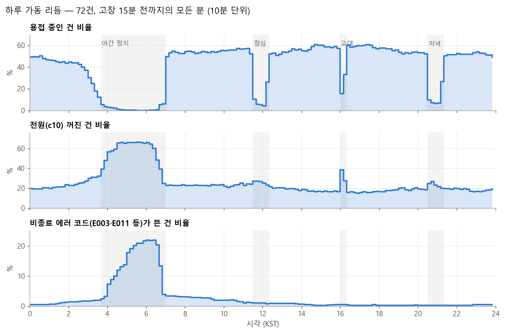
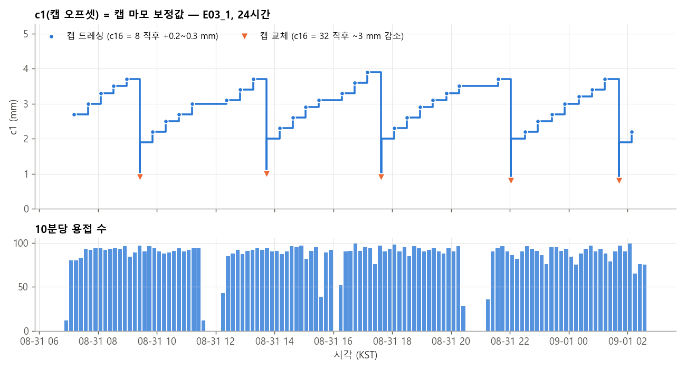
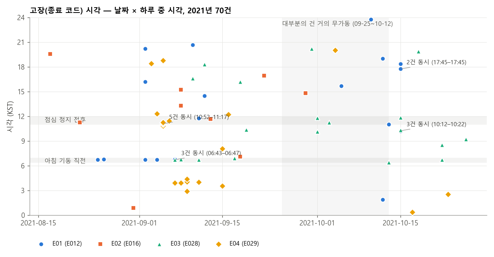

# RSW 원본 데이터 도메인 EDA (A-4, 2026-11-01)

피처 상관이 아니라 **건과 라인이 무엇을 하고 있었는지**를 1 Hz 원본에서 읽었다. 대상은 보존 파일 71개(학습 63 + 테스트 8; 결측 40% 초과 E02 8개와 10분짜리 E02_2 제외, 결측 분석에만 E02 8개 포함)다. 시각은 모두 KST(데이터는 naive UTC, +9시간)다. 재현: `python results/A-4/domain_eda.py events` → `report`(수치 `domain_eda.json`, 고장 맥락 `failure_context.csv`, 그림 `fig_*.png`).

**한 줄 요약**: 이 데이터의 리듬은 생산 일정(07시 기동·03시 정지·점심/저녁/교대 정지·일요일 휴무, 택트 ~77초)과 캡 관리(드레싱 ~28분·캡 교체 ~4시간)가 만든다. 결측의 71%는 기계가 아니라 기록이 멈춘 것이다. 비종료 에러 코드(E003·E011)는 야간 정지 상태 코드다. **"고장"의 상당수는 기동·전원 차단 순간에 여러 건에서 동시에 나고**, 같은 물리적 건이 여러 파일(서로 다른 고장 유형)로 들어 있다.

## 0. 한 행이 말하는 것

| 컬럼 | 원본에서 확인한 의미 |
|---|---|
| c11 (Welding point count) | 타점마다 +1. 1 Hz라 한 행에 0 또는 1(드물게 2) |
| c12 (Position count) | 타점마다 +2(닫힘·열림) |
| c18 / c4 | 용접 1타 = c18(건 닫기 명령) = 1, c4(힘 도달) = 1이 1~2초 |
| c13·c14·c16 | 그 타점의 프로그램(보정 압력·가압력·판 두께). 타점 사이 c13은 14.99로 돌아간다 |
| c15 | 열림 행정 설정값(B-17). 열려 있을 때 c3 ≈ c15, 가압 중 c3 ≈ −2 mm |
| c13 = c14 = c15 = c16 = 0 | 프로그램 없음. 건은 닫힌 채(c3 ≈ −2) 정지 |
| c1 (Electrode cap offset) | **캡 마모 보정값.** 드레싱마다 +0.2~0.3 mm, 캡 교체 때 ~3 mm 감소(3절) |
| c10 (US2, on/off) | 꺼지면 용접 0. 야간·휴식에 꺼진다 — 건 구동 전원(부하 전압)으로 보인다(가설, 6절) |
| c19 | 1초 단위로는 ±7만씩 오르내리지만 추세는 경과 시간(MEMORY §2의 누설 카운터) |

## 1. 하루·주간 가동 리듬

- **야간 정지**: 03시부터 용접이 줄어 03:40~06:50에는 거의 0, **07:00에 일제히 기동**(06:50 6% → 07:00 49%).
  - 04:30~06:00에는 건의 66%가 전원(c10) 꺼짐이다.
  - 비종료 에러 코드가 같은 시간에 22%까지 오르고 07시에 사라진다.
- **정지 시간대**: 점심 11:30~12:20(용접 4~10%), 저녁 20:30~21:20(6~10%), 교대 16:00~16:20(16~33%).
- **요일**: 일요일은 가동 분 비율 8%(평일 40~53%), 토요일 43%.
- **달력**:
  - 2021-08-16(광복절 대체공휴일)과 추석(09-20·21)은 거의 무가동이다.
  - **2021-09-25~10-12에는 그 기간을 덮는 건 대부분이 하루 용접 100회 미만**이다(긴 정지 또는 저가동 — 원인은 데이터로 알 수 없음). E01과 E03 일부 파일이 이 기간에 녹화됐다. 그래서 "E01 건은 용접이 적다"(README 5.3.1의 시간당 171회)는 건의 성질이라기보다 **녹화 시기의 성질**이다.

## 2. 결측(gap)은 두 종류다

60초 넘는 gap 1,017개(보존 파일)를 gap 동안 용접 카운터(c11)가 움직였는지로 나눴다.

| 종류 | 개수 | gap 중 용접 속도 / 평소 | gap 앞뒤 c10 꺼짐 | 언제 |
|---|---|---|---|---|
| **기록만 끊김**(생산은 계속) | 718 (71%) | 1.09배(중앙값) | 1% | 04~05시만 빼고 아무 때나 |
| **기계 정지**(카운터 그대로) | 286 (28%) | 0 | 72% | 04~06시 115건, 그 밖에 00~03·20~21·10~12·16시 |
| 일부만 | 13 | 0.21배 | 23% | — |

- 결측의 대부분은 **센서·통신 쪽 기록 누락이고 그동안 건은 평소 속도로 용접했다.** 이 구간에 "정지·이상"을 가정하면 틀린다.
- 기계 정지형 gap은 정지 일정(1절)과 겹친다. 결측 피처가 고장 신호가 아니었던 것(A-3)과 같은 이야기다.
- 결측 40% 초과 E02 8개도 같은 구성이다(기록만 끊김 199, 정지 167). 최장 기록 누락은 E02_12의 66시간(그동안 12만 타).

## 3. 캡 관리 주기 — c1이 마모 톱니를 그린다

| 이벤트 | 알아보는 법 | 주기(건별 중앙값) |
|---|---|---|
| **캡 드레싱** | c1 +0.1~0.6 mm. 93%가 직전 1분 안에 c16 = 8 프로그램(저압 가압 몇 번 = 드레싱·측정) | 227타 ≈ 28분, 회당 +0.3 mm |
| **캡 교체** | c1 −1 mm 이상. 99%가 직전 1분 안에 c16 = 32 프로그램 | 1,750타 ≈ 3.9시간, 교체 직전 c1 ≈ 3.2 mm(1.0~6.4) |

- **c16 = 0(프로그램 없음) 구간은 길이로 갈린다.**
  - 60초 이하(건·일당 ~30회)는 84%가 c1 변화 2분 안이다. 즉 **드레싱 동작 자체**다.
  - 10분 넘는 것은 야간 정지 시간대(03시)에 몰린다. 즉 **정지**다.
  - MEMORY §2의 "c16 ≤ 0 = 캡 드레싱 등"은 이 두 가지가 섞인 값이다.
- 짧은 전원 꺼짐(c10, 60초 이하, 건·일당 ~6회)은 드레싱과 14%만 겹친다. 원인은 데이터로 알 수 없다.
- 7일 동안 캡 교체가 c1에 안 보이는 건이 8개다. 대부분 고가동(5만~7.7만 타)이고 c1이 0~0.9 mm에 머문다. 이 건들은 마모 보정을 c1에 쌓지 않는 방식으로 보인다(미확인).

## 4. 생산 택트 — 차체 한 대 ~77초

타점 프로그램(c14·c16) 열에서 반복 주기를 찾았다. 용접 2,000타 이상인 68건 중 66건에 뚜렷한 반복이 있다.
- **주기 중앙값 14타 / 77초**(IQR 75~78초): 한 건이 차체 한 대에 14점을 찍고, 라인이 77초마다 한 대씩 흘러간다.
- 두 건(E04_7, E04_8)은 152~155초 — 한 대 걸러 일하는 건이다.
- 거의 쉬는 건도 있다: 7일 동안 E02_17 40타, test_5 72타, E04_5 109타, E03_9 1,652타.

## 5. 에러 코드의 운전 맥락

| 코드 | 에피소드 / 건 | 지속 중 | 시작 시각 | 해석 |
|---|---|---|---|---|
| E003 | 298 / 36 | 용접 0, c10 꺼짐 92%, 프로그램 없음 79% | 84%가 03~07시(04시 정점) | **야간 정지 상태 코드** |
| E011 | 150 / 11 | 용접 0, c10 꺼짐 91% | 78%가 03~07시, 51%가 일요일 | 정지·휴무 상태 코드 |
| E029 | 68 / 40 | 용접 0, c10 꺼짐 90%, 중앙 8분·최장 24시간 | 고르게 퍼짐(11시 정점) | 전원 꺼진 상태에서 뜨는 코드 |
| E012 | 34 / 25 | 용접 0, c10 꺼짐 45% | 06시 9건 | 기동 시 보정 압력 시간 초과 |
| E028 | 29 / 26 | 용접 0, c10 꺼짐 21% | 06시 8건 | 기동 시 위치 이탈 |
| E016 | 14 / 12 | 용접 0, c10 꺼짐 32% | 03~07시 0건, 근무 시간 | 생산 중 전극 감시 오류 |

B-14가 찾은 "비종료 코드 139건 중 103건이 새벽 03~05시"의 실체가 이것이다. 그 코드들은 **라인이 밤에 멈출 때 뜨는 상태 코드**이고, 고장 전조가 아니다.

## 6. 같은 물리적 건이 여러 파일에 있다

c7(소수 여섯 자리)·c8·c9는 건 고유 상수다. 79파일에 조합은 72개뿐이고, 용접 카운터(c11·c12)가 이어지는 것으로 같은 건임을 확인했다.

| 같은 건 | 고장 유형 | 관계 |
|---|---|---|
| E03_10 · E01_3 | E03 · E01 | **같은 주를 4.6시간 차이로 두 번 녹화**(시작 c11·c12 동일). 10-13 06:25 E028, 같은 날 11:02 E012 |
| E01_16 · E03_3 | E01 · E03 | 같은 주, 3.8시간 차이(겹침 164시간) |
| E04_17 · E01_13 | E04 · E01 | 5일 겹침, 고장은 2일 차이(09-05 E029, 09-07 E012) |
| E04_0 → E03_2 · E01_15 | E04 · E03 · E01 | 한 건에 세 파일. E03_2와 E01_15는 2.2일 겹침 |
| E04_16 · E01_12 | E04 · E01 | 다른 주(08-29~09-05, 10-08~10-15) |
| **test_0 · E03_9** | E01 · E03 | 다른 주 — **테스트 건이 학습 건과 같은 물리적 건** |

이것이 바꾸는 것:
- 겹치는 쌍에서는 한 파일의 "정상" 구간에 다른 파일의 고장이 들어 있다. 예를 들어 E01_3의 마지막 4.6시간 전에 같은 건의 E028 고장이 있다. 레이블이 오염된다.
- 건 단위 4-fold가 같은 데이터를 학습과 검증에 나눠 넣을 수 있다. B-2~B-18의 CV 수치는 그만큼 낙관적일 수 있다(크기 미확인).
- 테스트 8건 중 1건은 학습에 있던 건이다.

## 7. 고장은 어떤 순간에 나나

| 유형 | 건 | 06시대 | 10~11시대 | 직전 5분 용접 | 발생 시 c10 꺼짐 | 직전 5분 정지 코드(E003·E011) | 직전 5분 드레싱·교체 프로그램 |
|---|---|---|---|---|---|---|---|
| E01 (E012) | 20 | 5 | 4 | 8 | 12 | 5 | 4 |
| E02 (E016) | 11 | 0 | 2 | **10** | 1 | 0 | **8** |
| E03 (E028) | 20 | **7** | 6 | 8 | 2 | 6 | 3 |
| E04 (E029) | 21 | 0 | 6 | 5 | **18** | 0 | 3 |

- **E01·E03은 아침 기동 순간이 많다.** 06시대에 12건이고(11건이 06:43~06:55), 대부분 E003(정지 상태) 직후 전원이 막 켜진 순간이다. 09-25~10-12 정지가 끝난 10-15에도 E01·E03이 몰린다.
- **E04는 전원이 꺼진 상태에서 난다**(21건 중 18건). 야간 정지 시작(03:33~04:24)이나, **일요일 09-05 10:52~11:17에 다섯 건이 함께**(전원 차단) 났다.
- **E02만 생산 중에 난다.** 11건 중 10건이 직전 5분에 용접 중이었고, 8건은 직전 5분에 드레싱·캡 교체 프로그램이 돌았다.
  - 같은 시각의 다른 날과 비교하면 캡 교체 10분 안 18% vs 5%, 드레싱 10분 안 36% vs 22%다.
  - 다만 c16 = 8은 일부 건에서 일반 프로그램이기도 하다.
  - 정리하면, 드레싱·측정 루틴이 전극 이상을 잡을 때 E016이 뜨는 것으로 보인다. 마모·파손과 이어질 수 있는 유일한 유형이다.
- **동시 고장**: 다른 건 15분 안에 같이 난 고장이 4묶음 13건이다. E04 5건, 기동 3건(E03_17·E03_1·E01_13), 10-15 3건, 10-15 2건. 고장 72건은 서로 독립인 사건이 아니라 **라인 단위 사건**을 여러 건이 같이 겪은 것이 섞여 있다.

## 8. 이 발견이 바꾸는 것

1. **예지보전 해석.** E01·E03·E04 고장의 상당수는 마모가 쌓여 나는 고장이 아니라 **기동·정지(전원) 전환 순간의 상태 이상**이다. 전환은 매일 같은 시각에 오고, 같은 건도 다른 날 같은 전환에서는 고장 나지 않는다. 그래서 센서로 몇 시간 전에 예측할 대상이 애초에 적다. B-14·B-18의 음성 결과와 맞는 그림이다.
2. **실무에 쓸 수 있는 것**: "위험 순간" 안내 — 아침 기동, 전원 차단·복귀, 캡 교체 직후에 점검 안내를 띄우는 방식이다. 예측 모델이 아니라 일정 기반 안내이고, 효과는 데이터로 검증할 수 없다(전환은 매일 있고 고장은 한 번뿐).
3. **평가의 독립성.** 같은 건 중복(6묶음 13파일)과 동시 고장(4묶음 13건) 때문에 CV·테스트가 가정만큼 독립이 아니다. 앞으로 CV는 **물리적 건(c7·c8·c9) 단위**로 나누는 것이 맞다. 기존 수치의 낙관 크기는 재계산해야 안다.
4. **클래스 차이 해석.** 클래스는 녹화 시기(가동 수준)와 섞여 있다. E01이 저가동인 것은 대부분 09-25~10-12 저가동 기간 녹화 때문이다. 클래스별 신호를 비교할 때 이 시기 차이를 같이 봐야 한다.
5. **결측 처리**: 기록만 끊긴 gap이 대부분이라 "gap = 정지" 가정은 틀리다. 현재의 60초 채움 + 긴 gap 세그먼트 분리는 그대로 맞다.

## 9. 확인하지 못한 것

- c10(US2)의 정확한 의미 — 용접 0·야간 꺼짐과 맞는 "건 구동 전원"은 가설이다(매뉴얼 미확인).
- c16 = 8 / 32 프로그램 이름 — c1 변화와의 순서로 드레싱·교체로 추정했다.
- 09-25~10-12 저가동의 원인, 짧은 전원 꺼짐의 원인.
- 동시 고장 건들이 같은 셀·라인인지 — 파일에 위치 정보가 없다.
