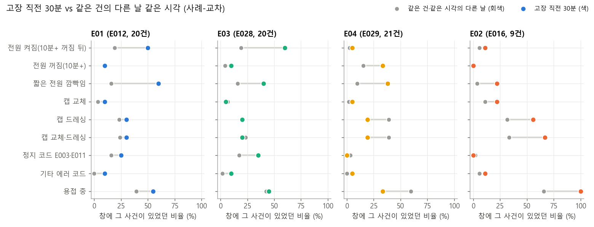
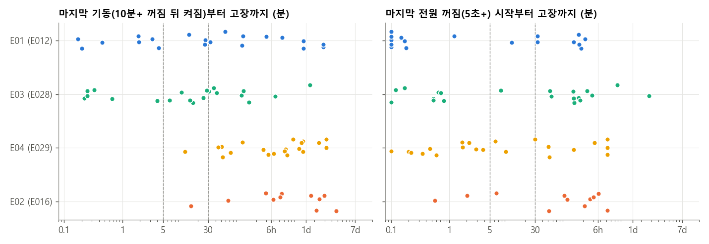

# 고장과 운전 전환 — 사례-교차와 전환 단위 비교 (A-5, 2026-11-01)

A-4가 눈으로 읽은 고장 순간을 **같은 건의 다른 날**, **같은 건의 다른 전환**과 비교해 검정했다. A-4가 읽은 것은 셋이다.
- E01·E03은 아침 기동에서 난다.
- E04는 전원이 꺼진 상태에서 난다.
- E02는 캡 드레싱·교체 근처에서 난다.

**대상과 입력**
- 대상: 보존 파일 72개(학습 64 + 테스트 8)의 고장 72건, 물리적 건 65개.
- 입력은 A-4 사건 캐시와 B-17 분 단위 캐시다. 원본을 다시 읽지 않았다.
- 판정 규칙은 계산 전에 `context.py` docstring에 고정했다.

**재현**: `python results/A-5/context.py crossover` → `transitions` → `figures`

| 파일 | 내용 |
|---|---|
| `crossover.json`·`.log` | 1부 사례-교차 |
| `transitions.json`·`.log`, `transitions_events.csv`, `failure_lags.csv` | 2부 전환 비교 |
| `fig_crossover.png`, `fig_lags.png` | 그림 |
| `overlap.py`, `overlap.json`·`.log` | 5절 후속: 깜빡임 vs 모델 조기 경보 |

**한 줄 요약**: E01·E03 "고장"은 **기동 점검 실패**이고, E04는 **전원 차단 상태에서 뜨는 코드**다.
- E01·E03: 기동(10분 넘게 꺼졌다 켜짐) 뒤 30분 안에 난 비율이 55%다. 같은 시각 다른 날의 19%보다 높다(OR 11.8, 사전 고정 가설 통과). 그런 24건 중 20건은 **켜진 뒤 용접을 한 번도 하지 않은 채** 났다.
- E04: 21건 중 18건이 꺼짐 구간 안에서 났다.
- **같은 건의 여러 기동 중 어느 것이 실패할지는 맥락으로 갈리지 않았다.** 정지가 길었던 기동 쪽으로 기울었지만 보정 후 유의하지 않다.
- 탐색 결과로, 고장 10–60분 전의 **짧은 전원 깜빡임**(5초–10분 꺼짐)이 36% vs 17%였다. 사전 고정 가설이 아니라서 확인이 필요하다.
  - 후속 확인(5절): 모델 조기 경보에 얹으면 +4.8점 [−1.3, +11.2]로 0과 구별되지 않았다. 테스트에서도 늘어난 적중이 없다. 그래서 **조기 경보에는 넣지 않는다**.

## 0. 설계

**사례-교차(case-crossover)**: 역학에서 드문 급성 사건의 일시적 요인을 볼 때 쓰는 설계다. 같은 대상이 사건 직전에 노출됐는지를 같은 대상의 다른 시점과 비교한다. 대상 사이의 차이(건 종류, 녹화 시기)는 상쇄된다.
- **사례 창**: 고장 T 직전 30분 [T − 30분, T). 10분 창과, 조기 경보 구간인 T − 60분 ~ T − 10분(선행 ≥ 10분)도 같이 냈다.
- **대조 창**: 같은 건, 같은 시각, 1~6일 전. 파일이 T − 7일에 시작하므로 6개까지다. B-18의 같은 시각 placebo와 같은 대조다.
- **사용 가능한 창**: 기록 비율이 50% 이상인 창만 쓴다. 사례 창과 대조 창 2개 이상이 있어야 한다. 72건 중 70건이 남았다.
- **효과**: Mantel–Haenszel 짝지은 오즈비(OR)다.
  - 사례 비율은 "그 사건 뒤 창 길이만큼 경보" 규칙의 적중률과 같다.
  - 대조 비율은 그 규칙의 같은 시각 우연이다. 둘 다 B-18과 같은 용어다.
- **불확실성**
  - 묶음 단위: 같은 물리적 건 또는 동시 고장(A-4 §7)을 하나로 묶었다. 72건이 56묶음이 됐다.
  - 95% CI는 묶음 부트스트랩 2000회다.
  - p는 묶음 순열 2000회다. 묶음마다 하루 차이 하나를 뽑아 가짜 사례로 쓰고, 양측으로 계산했다.
- **사전 고정 주 가설**(Holm 3개 보정): H1 E01+E03 × 기동, H2 E04 × 전원 꺼짐, H3 E02 × 캡 정비(교체·드레싱).
  - 통과 조건: 보정 p < 0.05이고 CI 하한 > 1.
  - 나머지는 모두 탐색이다.
- **방법 placebo**: 기준을 T − 1일로 옮겨 같은 계산을 했다. 주 가설의 CI가 1을 포함해야 설계가 치우치지 않은 것이다.

**사건 정의**
- 전원 사건은 A-4의 c10 꺼짐 구간으로 정한다.
  - 기동: 10분 이상 꺼짐의 끝.
  - 전원 꺼짐: 10분 이상 꺼짐의 시작.
  - 짧은 깜빡임: 5초–10분 꺼짐의 시작.
- 캡 정비는 c1 계단으로 정한다.
  - 드레싱: +0.05~0.6 mm.
  - 캡 교체: −0.5 mm 이하. A-4는 −1 mm였는데, −0.5~−1 mm 하락도 84%가 교체 프로그램(c16 = 32) 직후라 넓혔다.
- 정지 코드는 E003·E011 에피소드다.

## 1. 사례-교차 — 고장 직전 30분 vs 같은 시각 다른 날

**주 가설**

| 가설 | 건 | 고장 직전 30분 | 같은 시각 다른 날 | OR [95% CI] | p → Holm | 판정 | 방법 placebo OR |
|---|---|---|---|---|---|---|---|
| H1 E01+E03 × 기동 | 40 | **55%** | 19% | 11.8 [4.3, 110] | 0.0005 → 0.0015 | **통과** | 1.8 [0.5, 7.1] |
| H2 E04 × 전원 꺼짐 | 21 | **33%** | 15% | ∞ (아래) | 0.006 → 0.012 | 규칙상 통과, 크기 미정 | 2.3 [0.3, ∞] |
| H3 E02 × 캡 정비 | 9 | 67% | 33% | 7.0 [1.25, ∞] | 0.066 → 0.066 | 통과 못 함 | 0.3 [0, 3.0] |

- **H1**: 유형별로 E01 50% vs 19%(OR 10.3), E03 60% vs 19%(OR 13.3)다. 방법 placebo는 1 근처다.
- **H2**: OR이 무한대인 이유는 대조 쪽에만 전원 꺼짐이 있는 짝이 하나도 없어서다.
  - 대조 창에 꺼짐이 있던 건은 모두 고장 창에도 꺼짐이 있었다. 매일 같은 시각에 끄는 야간 정지다.
  - 순열 p는 유효하지만 효과 크기는 이 표본으로 정할 수 없다.
- **H3**: 9건뿐이다. 방향은 A-4와 같지만 검정력이 없다.

**탐색(보정 없음)**

| 사건 | 전체 70건 | E01 | E03 | E04 | E02 |
|---|---|---|---|---|---|
| 짧은 전원 깜빡임 | 43% vs 12% | 60% vs 16% | 40% vs 16% | 38% vs 10% | 22% vs 4% |
| 정지 코드 E003·E011 | 17% vs 11% | 25% vs 16% | 35% vs 17% | 0% vs 3% | 0% vs 2% |
| 용접 중 | 51% vs 50% | 55% vs 39% | 45% vs 42% | **33% vs 59%** | **100% vs 66%** |
| 캡 드레싱 | 27% vs 28% | 30% vs 23% | 20% vs 21% | **19% vs 39%** | 56% vs 32% |

- **30분·10분 창의 짧은 깜빡임은 고장 자체를 포함한다.**
  - E01은 20건 중 11건에서 꺼짐이 고장 1분 안에 시작됐고, 12건은 꺼짐 구간 안에서 고장이 났다(2절).
  - 그 꺼짐이 10분 미만이면 이 열에 잡힌다. 전조로 읽으면 안 된다.
- **E04는 직전에 용접·드레싱이 오히려 적다**(건이 꺼져 있었다).
- **E02는 사례-교차 9건 모두 직전 30분에 용접 중이었다**(같은 시각 66%). 생산 중 고장이다.

**조기 경보 구간(T − 60 ~ T − 10분, 선행 ≥ 10분) — 탐색**

이 구간은 고장 자체의 전원 차단이 섞이지 않는다. 짧은 꺼짐은 10분 안에 끝나고, 꺼짐 시작이 T보다 10분 넘게 앞서기 때문이다.

| 사건 | 고장 구간 | 같은 시각 | OR [95% CI] | p | 방법 placebo | 학습 64 / 테스트 8 |
|---|---|---|---|---|---|---|
| 짧은 전원 깜빡임 | **36%** | 17% | 3.2 [1.7, 6.3] | 0.003 | 13% vs 19% (OR 0.6) | 36% vs 19% / 3/8 vs 8% |
| 기동 | 27% | 15% | 2.5 [1.2, 4.4] | 0.036 | 15% vs 14% (OR 1.0) | 29% vs 17% / 1/8 vs 2% |

- 짧은 깜빡임은 네 유형 모두 같은 방향이다(E01 25/18, E02 33/16, E03 40/17, E04 43/18).
- 고장 구간 깜빡임의 31%는 기동 10분 안이다(대조 12%). 기동 절차와 일부 겹친다.
- 비용: 짧은 깜빡임은 건·일당 8.3회다. "깜빡임 뒤 10–60분 경보"의 정밀도는 2.1%다.
- 비교 대상은 B-20 모델 조기 경보다. 적중 49% vs 우연 34%(+15점), 오알람 16.4회/건·일이다.
  - 깜빡임 규칙은 +19점에 8.3회/건·일이다.
  - 다만 B-20 수치는 사전 고정 규칙이고, 이 수치는 사건 9개 × 창 3개에서 골라낸 탐색이다. 그대로 비교하면 안 된다.

## 2. 전환 단위 — 고장 시각과 마지막 전환 사이

0.1분 미만은 0.1에 그렸다. 점선은 5분·30분이다.

| 유형 | 기동 뒤 30분 안 | 고장 시점에 꺼짐 구간 안 | 꺼짐 시작 1분 안 | 전원 복귀 5분 안 | 마지막 용접 1분 안 |
|---|---|---|---|---|---|
| E01 (E012, 20건) | 10 | **12** | **11** | 9 | 4 |
| E03 (E028, 20건) | **12** | 2 | 8 | **12** | 6 |
| E04 (E029, 21건) | 1 | **18** | 6 | 3 | 2 |
| E02 (E016, 11건) | 1 | 1 | 1 | 2 | **10** |

- **E01**: 고장 코드가 전원 차단과 거의 동시에 뜬다. 꺼짐 시작에서 코드까지 중앙값은 0.2분이다. 이 차단은 고장의 결과로 보인다(컨트롤러가 이상에서 구동 전원을 끊는다). c10의 의미는 여전히 가설이다(A-4 §9).
- **E03**: 전원이 돌아온 직후에 뜬다. 중앙값 0.4분이고, 12건이 5분 안이다.
- **E04**: 꺼진 지 중앙값 3.8분 뒤 꺼진 상태에서 뜬다.
- **E02**: 10/11건이 용접 1분 안이다.
- 정의를 사후에 합친 기술 통계로 세면, 72건 중 **56건**이 "기동 30분 안 · 꺼짐 구간 안 · 복귀 5분 안" 중 하나에 든다. 나머지 16건 중 11건은 생산 중이다.

**기동에 이어진 고장 24건**(E03 12, E01 10, E02 1, E04 1)
- **20건은 켜진 뒤 용접 0타에서 났다.** 기동 점검 단계에서 실패한 것이다.
- 8건은 켜진 지 10–40초 만이다. 중앙값은 약 5분이다.
- 10건은 아침 기동(06:20–06:51)이다. 나머지는 낮 시간 재기동이고, 그중 몇은 긴 정지 뒤다(E03_6 46시간, test_5 3.6일, E03_13 25시간).

**같은 건의 다른 전환과 비교**
- 고장 난 전환이 그 건의 다른 전환(T − 60분 이전) 사이에서 몇 번째 백분위인지 본다. H0에서 평균은 0.5다.
- p는 순열 1만 회, CI는 묶음 부트스트랩이다.

| 가설 | 비교 | 건(다른 전환 중앙값) | 평균 백분위 [95% CI] | p → Holm | 판정 |
|---|---|---|---|---|---|
| P1 기동 전 꺼짐 길이 | 기동 24 | 24 (9개) | 0.63 [0.53, 0.74] | 0.051 → 0.10 | 통과 못 함 |
| P2 기동 전 마지막 용접 뒤 시간 | 기동 24 | 24 (9개) | 0.65 [0.51, 0.77] | 0.024 → 0.071 | 통과 못 함 |
| P3 꺼짐 시각이 평소와 다른 정도 | 꺼짐 11 | 11 (11개) | 0.33 [0.17, 0.52] | 0.063 → 0.10 | 통과 못 함(방향 반대) |

탐색으로 본 기동 직전 특징(백분위, p)은 다음과 같다.
- 정지 코드 10분 안: 0.59, p 0.011.
- 캡 교체 뒤 시간: 0.64, p 0.06.
- 기동 시각의 평소와 차이: 0.47.
- c1(캡 오프셋): 0.56.

**정리**: 실패한 기동은 정지가 더 길었던 기동 쪽으로 기운다. 하지만 기동 시각, 캡 상태, 직전 용접 간격 어느 것도 그 건의 다른 기동과 확실히 갈리지 않는다. 전원 꺼짐도 같다. E04 고장의 꺼짐은 평소 정지 시각에 오히려 가까웠다(계획된 야간 정지).

## 3. 이 결과가 바꾸는 것

1. **E01·E03에는 센서 전조가 있을 자리가 거의 없다.**
   - 고장 대부분이 기동 점검(보정 압력·위치)에서 드러나고, 그 직전 건은 꺼져 있거나 쉬고 있었다.
   - 수 시간 전 예지가 안 되는 이유(B-14)와, 조기 경보가 약한 이유(B-18·B-20)의 상당 부분이 여기서 설명된다.
   - 논문에서는 "이 벤치마크의 고장 레이블 다수는 상태 전환 사건"이라는 데이터 특성으로 쓸 수 있다. 72건 중 56건이 전환에 걸려 있다(사후 정의 기술 통계).
2. **E04 레이블은 전원 차단 상태를 알리는 코드에 가깝다.** 꺼진 뒤 몇 분 안에 꺼진 상태에서 뜬다. 마모 고장으로 읽으면 안 된다.
3. **기동 감시(일정 기반 안내)의 기대치**
   - 10분 넘게 꺼졌다 켜질 때마다 30분 안내를 띄우면 전체 고장의 34%를 덮는다(E01+E03은 55%). 같은 시각 우연은 12%다.
   - 건·일당 2.4회이고 정밀도는 2.0%다.
   - 선행 시간은 거의 없다. 3분의 1이 1분 안에 나기 때문이다. 그래서 예측이 아니라 "기동 중 점검을 지켜보라"는 안내다.
   - 정밀도는 파일 설계(7일마다 1건) 때문에 실제보다 높게 나온 값이다.
4. **어느 기동이 실패할지는 이 데이터로 고를 수 없다.** 같은 건의 기동끼리 맥락 차이가 확실하지 않다.
5. **짧은 전원 깜빡임(고장 10–60분 전)은 다음 가설 후보다.**
   - 방법 placebo는 깨끗하고, 학습·테스트와 네 유형에서 방향이 같다.
   - 하지만 사후 선택이고, 새 데이터가 없다.
   - 모델 조기 경보와의 겹침을 사전 고정 규칙으로 따로 쟀다(5절). 얹어도 추가분이 0과 구별되지 않아 넣지 않는다.

## 4. 한계

- **요일을 맞추지 않았다.** 파일이 7일이라 대조가 다른 요일이다.
  - 휴일·긴 정지 뒤 재가동(10-15), 일요일 전원 차단(09-05) 같은 **불규칙한 날**에는 모든 전환이 늘어난다.
  - 그래서 "전환 직후"와 "불규칙한 날"이 섞여 있다.
- **절대 위험은 구할 수 없다.** 파일이 고장에서 끝나도록 잘려 있어서다. 비율·정밀도는 상대 비교로만 읽어야 한다.
- **c10의 의미와 c1 계단의 이름은 추정이다**(A-4 §9). 꺼짐 구간은 기록 gap에서 끊지 않았다.
- **E02는 9건**이라 H3를 판정할 힘이 없다.
- **H2는 효과 크기를 정할 수 없다**(대조만 노출된 짝 0).
- **탐색 표의 p는 보정하지 않았다.** 사건 9 × 창 3 × 유형 6이다.

## 5. 후속: 짧은 전원 깜빡임이 모델 조기 경보에 보탬이 되나 (`overlap.py`)

3절 5항의 후보를 운영 조기 경보(B-20 / C-8)와 같은 잣대로 쟀다. 판정 규칙은 계산 전에 `overlap.py` docstring에 고정했다. 재현: `python results/A-5/overlap.py` → `overlap.json`·`.log`.

**규칙**: 세 가지를 비교했다. 지표는 B-18 `Frame.evaluate` 그대로다(적중 = 고장 10–60분 전 창의 경보, 우연 = 1~6일 전 같은 시각, 오알람 = 1시간 넘게 앞선 경보 시작/건·일).
- **모델**: B-20 고정 규칙(`model_ng_k1`, 폴드 밖 정상 점수 0.975 분위수).
- **깜빡임**: 5초–10분 c10 꺼짐이 시작된 창. 워밍업은 제외한다.
- **합침**: 둘 중 하나.

**표본과 통과 조건**
- B-19·B-20의 폴드 밖 점수 8벌(교차검증 64건)을 건별로 평균하고, 짝지은 건 부트스트랩을 쓴다. 테스트 8건은 방향 확인용이다.
- 통과하려면 네 조건을 모두 만족해야 한다.
  - D1(합침 − 모델)의 CI 하한 > 0.
  - D2(합침 − 같은 오알람 수의 모델)의 CI 하한 > 0. 같은 오알람 수의 모델은 분위수를 0.96으로 내린 것이다.
  - 합침이 하루 24회/건 이하.
  - 테스트 초과분이 모델보다 나쁘지 않을 것.

| 규칙 | 오알람/건·일 | 적중 | 우연 | 초과 [95% CI] | 테스트 적중(초과) |
|---|---|---|---|---|---|
| 모델(운영) | 16.4 | 48.8% | 34.3% | +14.6 [+5.9, +22.1] | 4/8 (+0.29) |
| 깜빡임 | **7.3** | 34.4% | 19.8% | **+14.6 [+4.0, +24.9]** | 3/8 (+0.29) |
| 합침 | 22.0 | 63.9% | 44.5% | +19.4 [+8.5, +29.3] | 4/8 (+0.22) |
| 모델 q 0.96(같은 오알람) | 23.9 | 56.2% | 43.3% | +13.0 [+3.7, +21.2] | 5/8 (+0.31) |

- 모델 행은 B-20의 8회 합침과 정확히 같다(검산).
- **D1 = +4.8점 [−1.3, +11.2]**: 0을 포함하므로 **통과 못 함**.
- D2 = +6.4점 [+0.6, +12.7]: 통과. 합침 22.0회는 상한 안이다.
- 테스트: 깜빡임이 잡은 3건(test_2·4·5)은 모두 모델도 잡은 건이다. 합침은 적중이 늘지 않고 우연만 늘어 **모델보다 나쁘다**.
- 겹침(교차검증 64건, 8벌 평균): 둘 다 12.4건, 모델만 18.9, 깜빡임만 9.6, 둘 다 못 잡음 23.1. 깜빡임은 모델이 놓친 고장을 ~10건 잡지만, 같이 늘어나는 우연 적중이 그 대부분을 상쇄한다.
- 유형별(적중/우연)로는 E04에서 깜빡임이 가장 강하다(50% / 19%). 모델은 46% / 35%다.

**판정: 사전 고정 규칙상 깜빡임은 조기 경보에 넣지 않는다.**
- 모델 위에 얹은 추가분이 0과 구별되지 않고, 테스트 방향도 반대다.
- 다만 깜빡임 단독은 모델 단독과 같은 초과분(+14.6점)을 오알람 절반 이하(7.3 vs 16.4회)로 낸다. 또 오알람을 더 쓸 거라면, 모델 임계값을 내리는 것(+13.0)보다 깜빡임을 더하는 것이 낫다(D2).
- 이 둘은 A-5에서 같은 고장으로 골라낸 신호라서 확인이 아니다. 현장 데이터에서 사전 고정 규칙으로 다시 재야 하는 가설이다.
